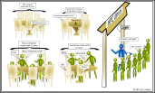

:::::::::::::::::::::::::::::::::::::: questions 

- What is a scheduler and why are they used?
- How do I launch a program to run on any one node in the cluster?
- How do I capture the output of a program that is run on a node in the cluster?

::::::::::::::::::::::::::::::::::::::::::::::::

:::::::::::::::::::::::::::::::::::::: objectives

- Run a simple Hello World style program on the cluster.
- Submit a simple Hello World style script to the cluster.
- Use the batch system command line tools to monitor the execution of your job.
- Inspect the output and error files of your jobs.

::::::::::::::::::::::::::::::::::::::::::::::::

## Job scheduler

An HPC system might have thousands of nodes and thousands of users. How do we decide who gets what
and when? How do we ensure that a task is run with the resources it needs? This job is handled by a
special piece of software called the scheduler. On an HPC system, the scheduler manages which jobs
run where and when.

The following illustration compares these tasks of a job scheduler to a waiter in a restaurant.
If you can relate to an instance where you had to wait for a while in a queue to get in to a 
popular restaurant, then you may now understand why sometimes your job does not start instantly
as in your laptop.

{width='75%'}

:::::::::::::::::::::::::::::::::::::: challenge

### Job scheduling roleplay (optional)

Your instructor will divide you into groups taking on different roles in the cluster (users,
compute nodes and the scheduler). Follow their instructions as they lead you through this
exercise. You will be emulating how a job scheduling system works on the cluster.

[*notes for the instructor here*](../instructors/instructor-notes.md)

::::::::::::::::::::::::::::::::::::::::::::::::

The scheduler used in this lesson is Slurm. Although Slurm is not used everywhere,
running jobs is quite similar regardless of what software is being used. The exact syntax might change, but the
concepts remain the same.

## Running a batch job

The most basic use of the scheduler is to run a command non-interactively. Any command (or series 
of commands) that you want to run on the cluster is called a *job*, and the process of using a
scheduler to run the job is called *batch job submission*.

In this case, the job we want to run is just a shell script. Let's create a demo shell script to 
run as a test.

:::::::::::::::::::::::::::::::::::::: challenge

### Creating our test job

Using your favorite text editor, create the following script (`example-job.sh`) and run it. Does it run on the
cluster or just our login node?

```bash
#!/bin/bash --login

echo 'This script is running on:'
hostname
sleep 120
```
::::::::::::::::::::::::::::::::::::::::::::::::

If you completed the previous challenge successfully, you probably realise that there is a
distinction between running the job through the scheduler and just "running it". To submit this job
to the scheduler, we use the sbatch command.

```bash
[user@login ~]$ sbatch example-job.sh
```

```output
Submitted batch job 123456
```
And that's all we need to do to submit a job. Our work is done -- now the scheduler takes over and
tries to run the job for us. While the job is waiting to run, it goes into a list of jobs called
the queue. To check on our job's status, we check the queue using the command squeue -u $USER.

```bash
[user@login ~]$squeue -u$USER
```

```output
Code snippet

             JOBID PARTITION     NAME     USER ST       TIME  NODES NODELIST(REASON)
            123456   compute example-     user  R       0:05      1 compute-01
```

We can see all the details of our job, most importantly that it is in the "R" or "RUNNING" state.
Sometimes our jobs might need to wait in a queue ("PENDING") or have an error. The best way to check
our job's status is with squeue. Of course, running squeue repeatedly to check on things can be
a little tiresome. To see a real-time view of our jobs, we can use the watch command. watch
reruns a given command at 2-second intervals. This is too frequent, and will likely upset your system
administrator. You can change the interval to a more reasonable value, for example 60 seconds, with the
-n 60 parameter. Let's try using it to monitor another job.

```bash
[user@login ~]$ sbatch example-job.sh
[user@login ~]$watch -n 60 squeue -u$USER
```

You should see an auto-updating display of your job's status. When it finishes, it will disappear
from the queue. Press Ctrl-C when you want to stop the watch command.

## Customising a job

The job we just ran used all of the scheduler's default options. In a real-world scenario, that's
probably not what we want. The default options represent a reasonable minimum. Chances are, we will
need more cores, more memory, more time, among other special considerations. To get access to these
resources we must customize our job script.

Comments in UNIX (denoted by #) are typically ignored. But there are exceptions. For instance the
special #! comment at the beginning of scripts specifies what program should be used to run it
(typically /bin/bash) possibly with switches such as /bin/bash --login to select a certain behaviour of the program. Schedulers like Slurm also have a special comment
used to denote special scheduler-specific options. Though these comments differ from scheduler to
scheduler, Slurm's special comment is #SBATCH.
Anything following the #SBATCH comment is interpreted as an
instruction to the scheduler.

Let's illustrate this by example. By default, a job's name is the name of the script, but the
--job-name (or -J) option can be used to change the name of a job.

Submit the following job (sbatch example-job.sh):

```bash
#!/bin/bash --login
#SBATCH --job-name=new_name

echo 'This script is running on:'
hostname
sleep 120
```

```bash
[user@login ~]$squeue -u$USER
```

```output
JOBID PARTITION     NAME     USER ST       TIME  NODES NODELIST(REASON)
            123457   compute new_name     user  R       0:02      1 compute-01
```

Fantastic, we've successfully changed the name of our job!

:::::::::::::::::::::::::::::::::::::: challenge
Setting up email notifications

Jobs on an HPC system might run for days or even weeks. We probably have better things to do than
constantly check on the status of our job with squeue. Looking at the
man page for sbatch, can you set up our test job to send you an email
when it finishes?

:::::::::::::::: solution

Add the --mail-type and --mail-user flags to your Slurm script header:

```bash
#SBATCH --mail-type=END
#SBATCH --mail-user=your.email@domain.ac.uk
```

:::::::::::::::::::::::::
::::::::::::::::::::::::::::::::::::::::::::::::
Resource requests

But what about more important changes, such as the number of cores and memory for our jobs? One
thing that is absolutely critical when working on an HPC system is specifying the resources
required to run a job. This allows the scheduler to find the right time and place to schedule our
job. If you do not specify requirements (such as the amount of time you need), you will likely be
stuck with your site's default resources, which is probably not what we want.

The following are several key resource requests:

- --nodes=<N> (-N): Number of nodes required.
- --ntasks=<N> (-n): Number of tasks (processes) to launch.
- --cpus-per-task=<N> (-c): Number of CPU cores per task.
- --mem=<size>: Total memory required per node (e.g., 4G).
- --time=<HH:MM:SS> (-t): Maximum walltime limit.

Note that just requesting these resources does not make your job run faster! We'll talk more
about how to make sure that you're using resources effectively in a later episode of this lesson.

:::::::::::::::::::::::::::::::::::::: challenge
Submitting resource requests

Submit a job that will use 1 full node and 5 minutes of walltime.

:::::::::::::::: solution

```bash
#!/bin/bash --login
#SBATCH --nodes=1
#SBATCH --time=00:05:00

echo 'Running on 1 full node for up to 5 minutes'
hostname
```
:::::::::::::::::::::::::
::::::::::::::::::::::::::::::::::::::::::::::::

Resource requests are typically binding. If you exceed them, your job will be killed. Let's use
walltime as an example. We will request 30 seconds of walltime, and attempt to run a job for two
minutes.

```bash
[user@login ~]$ sbatch example-job.sh
[user@login ~]$watch -n 60 squeue -u$USER
[user@login ~]$ cat slurm-123458.out
```

```output
Starting long job..
slurmstepd: error: *** JOB 123458 ON compute-01 CANCELLED AT 2026-11-12T16:00:35 DUE TO TIME LIMIT ***
```

Our job was killed for exceeding the amount of resources it requested. Although this appears harsh,this is actually a feature. Strict adherence to resource requests allows the scheduler to find the best possible place for your jobs. Even more importantly, it ensures that another user cannot use more resources than they've been given. If another user messes up and accidentally attempts to use all of the cores or memory on a node, Slurm will either restrain their job to the requested resources or kill the job outright. Other jobs on the node will be unaffected.This means that one user cannot mess up the experience of others, the only jobs affected by a mistake in scheduling will be their own.

## Cancelling a job   

Sometimes we'll make a mistake and need to cancel a job. This can be done with the scancel
command. Let's submit a job and then cancel it using its job number (remember to change the wall time so that it runs long enough for you to cancel it before it is killed!).

```bash
[user@login ~]$ sbatch example-job.sh
[user@login ~]$squeue -u$USER
```

```output
JOBID PARTITION     NAME     USER ST       TIME  NODES NODELIST(REASON)
            123459   compute example-     user  R       0:03      1 compute-01
```

Now cancel the job with its job number. Absence of any job info indicates that the job has been
successfully cancelled. Note that it might take a minute for the job to disappear from the queue.

```bash
[user@login ~]$ scancel 123459
[user@login ~]$squeue -u$USER
```

```output
JOBID PARTITION     NAME     USER ST       TIME  NODES NODELIST(REASON)
```

## Other types of jobs

Up to this point, we've focused on running jobs in batch mode. Slurm also provides the ability to start an interactive session.   There are very frequently tasks that need to be done interactively. Creating an entire job script might be overkill, but the amount of resources required is too much for a login node to handle. A good example of this might be building a genome index for alignment with a tool like HISAT2. Fortunately, we can run these types of
tasks as a one-off with srun or salloc.

```bash
[user@login ~]$ srun --time=00:30:00 --mem=4G --pty bash
```

:::::::::::::::::::::::::::::::::::::: keypoints

- The scheduler handles how compute resources are shared between users.
- Everything you do should be run through the scheduler.
- A job is just a shell script.
- If in doubt, request more resources than you will need.

::::::::::::::::::::::::::::::::::::::::::::::::
